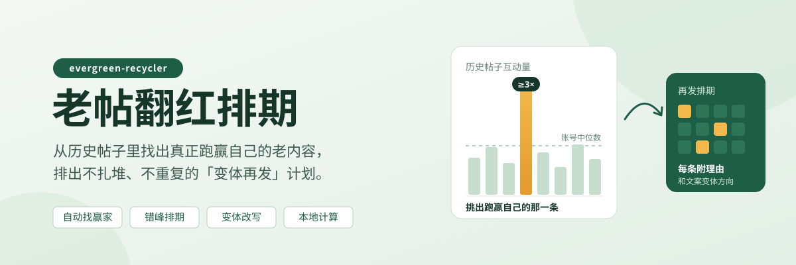
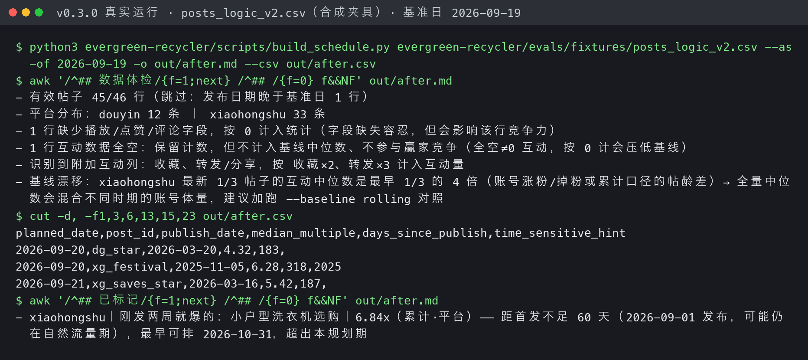
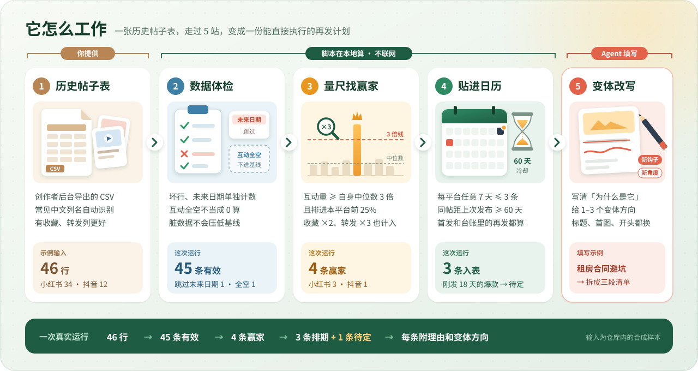

# 老帖翻红排期 · evergreen-recycler

**把创作者后台导出的历史帖子表交给它，拿回一份「翻哪几条、哪天发、文案怎么改」的再发计划。**

---

## 效果展示

下面是一次真实运行：输入是仓库里的合成样本（46 条帖子，小红书 34 条、抖音 12 条），基准日 2026-09-19。终端内容逐字取自运行结果，没有删改。

从这张截图能看到它替你做的判断：

- **坏数据不混进来**：一条发布日期晚于基准日的帖子被跳过并单独说明。
- **收藏型干货也能被认出**：「租房合同逐条避坑」阅读只有 2400，但收藏 3000，照样入选。
- **时效内容会提醒**：「2025 双十一囤货清单」入选，但标了时效，请你先确认今年还成立。
- **刚爆的帖子不急着翻**：发布才 18 天的爆款进入待定，并写明最早 10 月 31 日再排。

生成的排期表节选（[完整排期表](evals/runs_v2/logic_schedule.md)）：

| 排期日 | 平台 | 帖子 | 互动量 / 平台中位数 | 距首发 |
| --- | --- | --- | --- | --- |
| 09-20 周日 | 抖音 | 老房子水电改造避坑全记录 | 4.32 倍 | 183 天 |
| 09-20 周日 | 小红书 | 2025 双十一囤货清单 ⚠ 疑似时效 | 6.28 倍 | 318 天 |
| 09-21 周一 | 小红书 | 收藏型干货：租房合同逐条避坑 | 5.42 倍 | 187 天 |

随后 Agent 为每条写上「为什么是它、文案怎么改」，例如租房合同这条（[完整填写示例](evals/runs_v2/agent_variants_sample_v2.md)）：

> **为什么是它**：阅读只有 2400，但收藏 3000、转发 400。收藏超过阅读，说明读者把它当工具文档保存，是典型的常青内容。
>
> **变体方向**：① 首图换成合同里一条具体的坑款原文截图，标题改问句「这条押金条款你签过吗？」；② 拆成「签约前 / 入住时 / 退租时」三段清单；③ 换一个城市或换成合租场景，避免与原帖首图、首句雷同。

## 它能做什么

- **自动找赢家**：只和你自己的历史比。互动量达到账号中位数 3 倍、并排进前 25% 的帖子才算赢家，收藏和转发也计入。
- **错峰排期**：每个平台任意 7 天最多 3 条；同一帖子距上次发布（包括首发）至少隔 60 天；记进台账的再发不会被重复排。
- **账号体量变化也不失真**：前后期互动差距大时会提醒，并可以改成和「同时期的帖子」比较。
- **数据体检**：缺字段能容忍；坏行、未来日期、互动全空的行单独计数，不悄悄算成 0。
- **只给变体，不原样重发**：每条排期附 1-3 个改写方向（新钩子、新角度、换开头案例、更新数据）。
- **样本太少就如实说**：某平台不足 10 条只标记不排期；全账号不足 20 条只建议先攒数据。

## 适合谁

| 典型场景 | 你是谁 | 它帮你做什么 |
| --- | --- | --- |
| 月度翻红盘点 | 个人博主、小团队 | 从几十上百条旧帖里挑出值得再做一遍的几条，排好日期 |
| 多平台错峰再发 | 同时经营小红书、抖音、微博 | 各平台分开排期，不扎堆、不撞车 |
| 接手旧号复盘 | 接手别人账号的运营 | 先看数据体检和赢家清单，弄清哪些旧选题值得用新写法再做 |

它不做：追热点、粉丝增长诊断、竞品分析、自动发布。

## 如何安装

把本仓库的 GitHub 地址发给你正在用的 Codex、Claude Code 或其他支持 Skills 的 Agent，并告诉它：

> 请安装这个 Skill 仓库，装好后确认它出现在可用 Skills 里。

安装后重新打开会话即可。手动安装和命令行参数见[使用文档](docs/usage.md)。

## 如何使用

准备一份历史帖子表：平台、标题、发布日期、播放、点赞、评论；有收藏和转发更好。常见中文列名会自动识别。然后直接说：

> 这是我从创作者后台导出的帖子数据，帮我挑出值得翻红的老帖，排一份下个月的再发计划，每条告诉我为什么是它、文案怎么改。

> 我的账号今年涨粉很快，帮我按同时期的帖子比较，看看早期有没有被埋没的好内容。

> 这是上次的再发记录，排新计划时避开最近发过的，每条帖子最多翻两次。

发布后把执行情况回填到排期表、把再发日期记进台账，下次运行会自动避开。字段与判断规则见[排期规则与字段](references/排期规则与字段.md)。

## 对标与参考

| 对标 | 它们怎么做 | 本项目的不同 |
| --- | --- | --- |
| CoSchedule ReQueue、SmarterQueue | 人工把帖子放进常青队列循环发 | 从你的导出表里**自动**找出值得翻的帖子 |
| Revive Old Posts、OpenTweet | 设最小帖龄、冷却期 | 同样有冷却期，还把首发也算进间隔 |
| vidIQ Outliers、Vamos | 和频道自身水平比，用倍数找爆款 | 同样只和自己比，面向小红书、抖音等平台的导出表 |
| Postiz 等开源排期工具 | 按固定周期重复发布 | 不接管账号，只给变体建议，发不发由你决定 |

每条规则的出处和取舍见 [references/benchmarks.md](references/benchmarks.md)。

## 效果怎么验证

所有排期规则都用合成样本跑过完整流程，再由评测脚本对真实产物逐项复算（赢家倍数、排期间隔、台账防重复、结果可复现等）。用例、量表和全部产物见[评测说明](evals/README.md)。

## 边界与注意事项

- **隐私**：全部在本地计算，不联网、不需要授权任何平台账号。帖子表含账号经营数据，别公开原件。
- **不是流量承诺**：赢家只是和你自己的历史相比；评测用的是合成样本，没有在真实账号上验证翻红后的流量。
- **平台规则未公开**：同账号重复内容的判定细则平台没有公布。60 天间隔取常见区间的下沿，规则变化时请自行收紧。
- **只看标题**：时效提示只看标题里的年份、节日、大促等词，会漏报也会误报，只提示不替你删。
- **红线**：只建议变体重发，不建议原样重发；重发也不等于删掉原帖。它不会替你发布任何内容。

## 社区与许可

- 社区讨论：[LINUX DO — 中文开发者社区](https://linux.do/)
- 许可证：[Apache License 2.0](LICENSE)。第三方名称与资料说明见 [NOTICE](NOTICE)。
