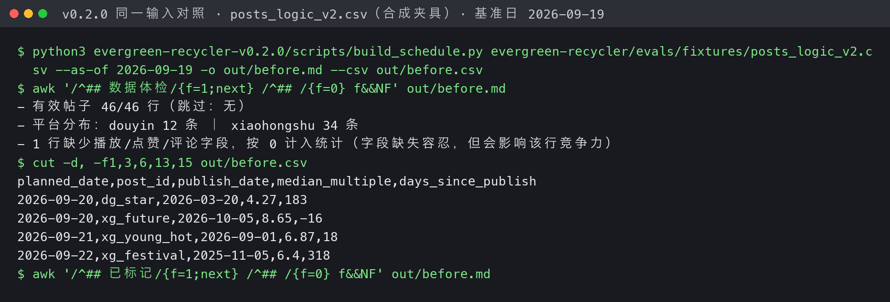
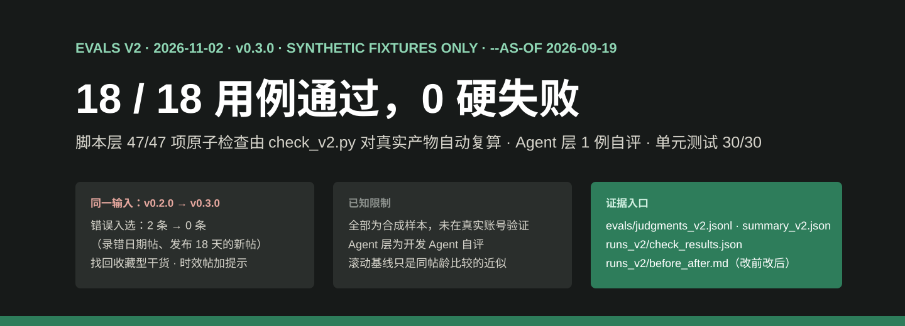

# 老帖翻红排期 evergreen-recycler

  

给自媒体博主用的老帖翻红排期工具：把创作者后台导出的历史帖子表交给它，它会找出真正跑赢你自己基线的老帖，排出不扎堆、不重复的再发计划，并为每条写好「为什么是它、文案怎么改」。

全部在本地计算，不需要授权任何平台账号。它只给「变体重发」建议，不会建议原样重发，也不会替你发布。

## 当前版本实际跑出来的样子

下面是 v0.3.0 的一次真实运行。输入是仓库里的合成样本（46 条帖子，小红书 34 条、抖音 12 条），基准日 2026-09-19。命令和输出都逐字取自终端，没有删改：

  

这次运行里它做了几件事：

- 一条发布日期录成 10 月 5 日（晚于基准日）的帖子被当成坏数据跳过，没有混进排期；
- 收藏 3000、阅读只有 2400 的「租房合同逐条避坑」被认出是收藏型干货，排进了计划；
- 「2025 双十一囤货清单」入选了，但标了时效提示（命中词「2025」），要你先确认内容在今年是否还成立；
- 发布才 18 天的爆款没有被马上翻红，而是放进待定，并写明最早 10 月 31 日才能排；
- 账号后期的互动量是前期的 4 倍，它提示你加跑「同时期对比」。加跑后，账号早期一条跑赢同期 3.7 倍的帖子也被找了回来（[完整产物](evals/runs_v2/logic_rolling.md)）。

同一份输入交给上一版 v0.2.0，排出的 4 条里有 2 条是错的：录错日期的帖子排在第一位（「距首发 -16 天」），发布 18 天的新帖被安排在第 20 天再发。收藏型干货则没有被选中：

  

逐项对比见[改前改后对照](evals/runs_v2/before_after.md)，Agent 为每条排期补写的理由和文案变体方向见[填写示例](evals/runs_v2/agent_variants_sample_v2.md)。

## 适合谁、什么时候用

| 场景 | 你是谁 | 它帮你做什么 |
| --- | --- | --- |
| 月度翻红盘点 | 个人博主、小团队 | 自动挑出跑赢自己基线 3 倍以上的老帖，按「每个平台任意 7 天最多 3 条」排好日期 |
| 多平台错峰再发 | 同时经营小红书、抖音、微博的博主 | 各平台分开排期；同一帖子距上次发布（包括首发）至少隔 60 天；台账记过一次就不会重复排 |
| 接手旧号复盘 | 接手别人账号的运营 | 先看数据体检和赢家清单，弄清哪些旧选题值得用新写法再做一遍 |

它不做这些事：追热点、粉丝增长诊断、竞品分析、自动发布。

## 能力与边界

| 能力 | 边界 |
| --- | --- |
| **找赢家**：互动量（播放 + 赞×2 + 评×3 + 收藏×2 + 转发×3，后两项有数据才计入）达到账号基线中位数的 3 倍，并且排在前 25%。每条都附倍数和分位数，可以自己复核 | 只和你自己的历史比，不是流量承诺；权重可以调 |
| **两种基线**：默认和同平台全部帖子比较；账号前后体量差 2 倍以上时会提示，可以改成和「发布时间最接近的 20 条」比较 | 导出数据只有当前累计值，「同时期比较」只能近似同帖龄比较 |
| **排期约束**：每平台任意 7 天最多 3 条；同一帖子距上次发布（包括首发）至少 60 天；同平台排期日至少隔 1 天；可以设置每条帖子最多翻几次 | 平台对同账号重复内容的判定细则没有公开。60 天取的是常见 60-90 天区间的下沿，平台规则变了要自己收紧 |
| **自动降级**：某个平台少于 10 条只标记、不排期；全账号少于 20 条只给「先攒数据」建议 | 这是有意保守：样本太小时，分位数不可信 |
| **数据体检**：缺字段容忍；坏行、未来日期、互动全空的行单独计数，不悄悄算成 0 | 导出列名太特殊时需要手动改表头 |
| **时效提示**：标题含年份、节日、大促、直播、抽奖等词时会提醒 | 只看标题，会漏报也会误报，只提示，不替你删 |
| **变体方向**：Agent 按帖子内容给出 1-3 个改写方向（新钩子、新角度、换开头案例、更新数据） | 只是建议；发不发、怎么发由你决定 |

**红线：** 只做「变体重发」，不原样重发；重发也不等于删掉原帖。小红书 2026 年 4 月的 AI 内容治理规则点名了「套用模板批量生产同质化内容」，抖音 2025 年 4 月的恶意营销号治理规范点名了「频繁发布抄袭搬运内容、批量发布同质化内容」。网上流传的「小红书 180 天内容指纹」找不到官方出处，本项目从 v0.3.0 起不再把它当事实写。

## 如何安装与使用

把本仓库放进你的 Agent 技能目录（仓库自带一个安装脚本，会备份旧版本后复制到 Codex 的技能目录）。然后直接对 Agent 说：

> 「这是我从创作者后台导出的帖子数据，帮我挑出值得翻红的老帖，排一份下个月的再发计划，每条告诉我为什么是它、文案怎么改。」

Agent 会先让脚本做数据体检，再找赢家、排期，然后：

- 遇到基线漂移，主动加跑同时期对比，并解释两份结果哪里不同；
- 遇到刚发不久的爆款，告诉你它还在自然流量期，要等到哪天再排；
- 遇到疑似时效内容，先问你日期、价格、活动是否还成立；
- 为每条排期写理由和变体方向。

发布以后，把执行情况回填到排期表，再把再发日期记进台账。下次运行会自动避开 60 天内的重复，也可以限制每条帖子最多翻几次。

你只需要提供一份历史帖子表，包含平台、标题、发布日期、播放、点赞、评论；有收藏和转发更好。常见中文列名会自动识别。命令行参数、退出码、台账格式和复现方法见[使用文档](docs/usage.md)，判断规则见[字段与规则](references/排期规则与字段.md)。

## 对标与参考

这一版的改动来自一轮外部调研（检索日期 2026-11-02），每条逻辑的出处都写在 [references/benchmarks.md](references/benchmarks.md)：

- **常青回收工具**：CoSchedule ReQueue、SmarterQueue、Revive Old Posts、SocialBu、UniLink、OpenTweet，以及开源的 Postiz（重复周期最长 1 个月）和 TryPost 提案。本项目借鉴了它们的「最小帖龄 / 冷却期」「单帖回收次数上限」「跳过时效内容」「文案变体轮换」。
- **爆款（outlier）检测口径**：vidIQ（和频道「同一时间段」比）、Vamos（和自己的中位数比，至少 10 条）、OutlierKit（3 倍以上算显著）、Overseer 基准报告（按相同帖龄比较、排除自身、20-30 条样本高置信）。本项目的「3 倍中位数」和「同时期滚动基线」都来自这里。
- **方法论**：NIST 工程统计手册的稳健离群检测，支持用中位数而不是均值做基线；小红书 CES 互动分（第三方转述）和 Instagram 负责人关于转发信号的说法，支持把收藏和转发算进互动量。
- **差异化**：上面的回收工具都靠人工标记哪条值得回收，而且大多要授权绑定账号；outlier 工具只看 YouTube 播放。本项目从你自己的导出表里自动找赢家，排期规则可以复核，输出的是变体建议，不接管账号。

调研中发现的 12 个逻辑问题、哪些改了、哪些没改及原因，见[迭代记录](evals/iteration_notes.md)第 6 轮。

## 评测结果

V2 评测（2026-11-02，v0.3.0）。所有输入都是合成样本，基准日固定为 2026-09-19：

- **18 个用例全部通过，0 个硬失败。** 其中脚本层 17 个用例的 **47 项原子检查**由评测脚本对真实产物自动复算，包括按「最近 20 条、不含自身」独立重算滚动倍数、重算排除空行后的中位数；Agent 层 1 个用例按量表自评。
- 覆盖：赢家检测、排期约束、稀疏降级、台账防重复、全输家如实给空结果、冷启动、两次运行 sha256 一致、缺字段容忍、变体红线，以及本轮新增的 7 类回归（未来日期、新帖冷却、收藏和转发、滚动基线、样本门槛参数、时效提示、互动全空）。
- 向后兼容：旧主夹具（67 行、5 个平台）在默认参数下的排期，与 v0.2.0 逐行一致。

  

证据：[逐题判断](evals/judgments_v2.jsonl)、[汇总](evals/summary_v2.json)、[自动复算结果](evals/runs_v2/check_results.json)、[全部产物](evals/runs_v2/)、[评测说明](evals/README.md)。

## 失败案例与已知限制

- **v0.2.0 的真实问题**（本版已修）：录错日期的帖子会被排第一；刚发两周的爆款会被马上翻红；收藏、转发被忽略；改了样本门槛，报告文案却还写默认值；把查不到出处的「180 天内容指纹」写成事实。
- **评测范围**：全部是合成样本，验证的是「规则有没有按设计执行」，**没有在真实账号上验证翻红后的流量**。那需要发布后的回流数据，目前要靠你下一期重新导出来对比。
- **自评**：Agent 层由开发 Agent 自己评分，没有独立人工复核；也没有「不用这个工具」的对照组，对照对象是上一版本。
- **近似**：滚动基线和日均口径都只是「按相同帖龄比较」的近似；时效提示只看标题。
- **默认值的变化**：发布不足 60 天的赢家现在会进入待定而不是立即排期。如果你确实想更早翻，可以手动调小间隔，但不建议。

## 社区与许可

- 社区讨论：[LINUX DO](https://linux.do/)
- 许可证：Apache License 2.0（见 [LICENSE](LICENSE)；第三方名称与资料说明见 [NOTICE](NOTICE)）
